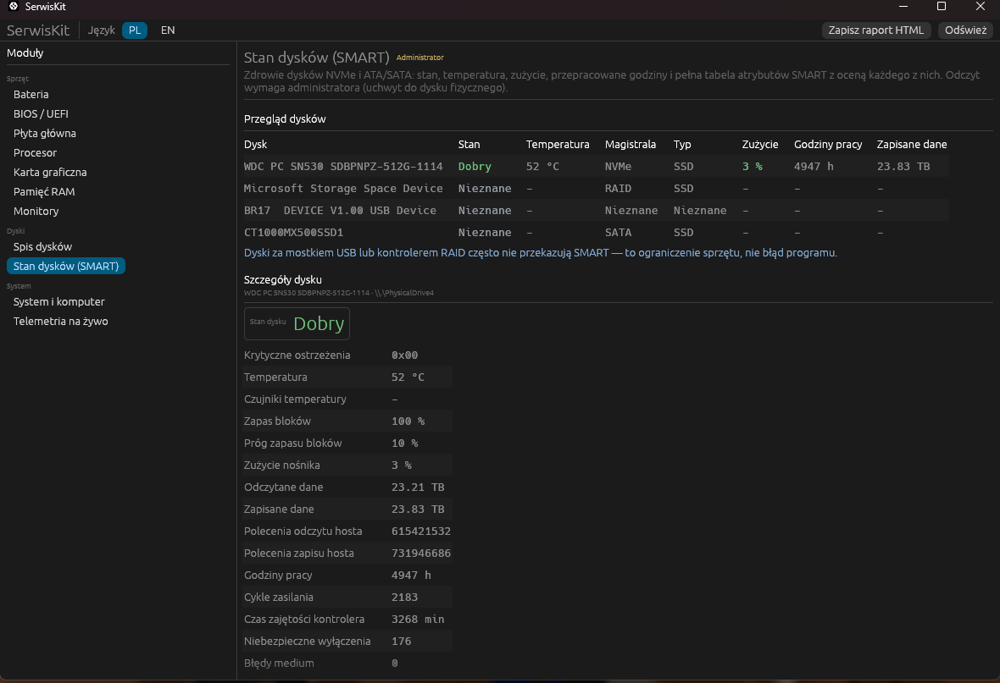
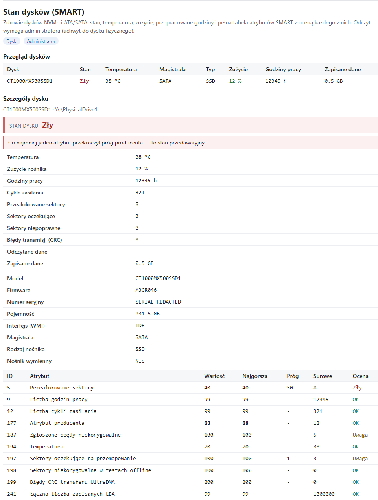
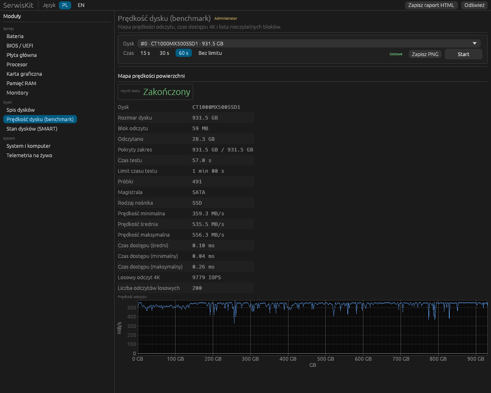
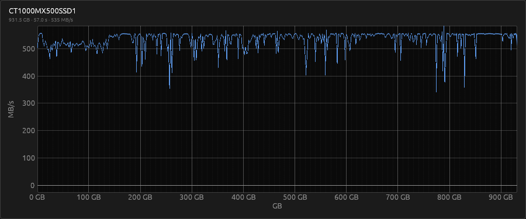
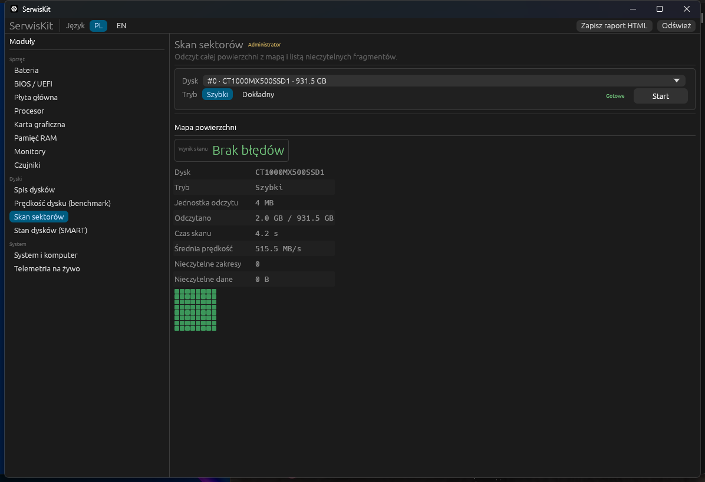
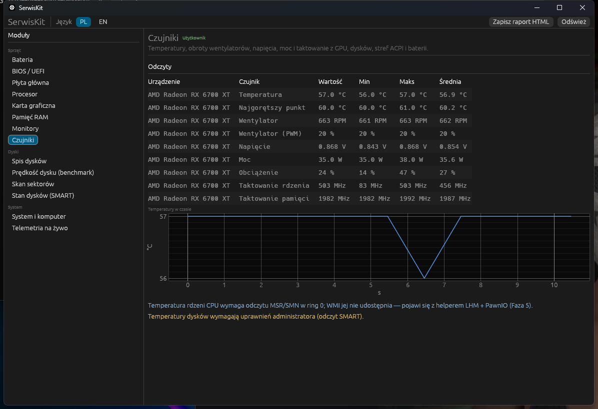

# SerwisKit

Narzędzie serwisowe dla Windows 10/11 x64: diagnostyka sprzętu (jak AIDA64), testy dysków i SMART (jak HD Tune / CrystalDiskInfo) oraz migracja profili przeglądarek między komputerami. Jeden plik `.exe`, praca offline, moduły dokładane przez kontrybutorów.

Projekt open source. Status: **Faza 1 ukończona, Faza 2 w toku** — działa GUI + CLI + jawny rejestr modułów, 14 modułów (telemetria AIDA‑lite, wykresy live, czujniki GPU/ACPI/baterii i temperatura dysków, SMART NVMe i ATA/SATA, benchmark prędkości powierzchni, skan sektorów) i raport JSON/HTML. Kolejne fazy: `docs/PLAN.md` §8.


Stan dysków (SMART) w układzie jak CrystalDiskInfo: stan i temperatura każdego nośnika w przeglądzie, baner oceny, wskaźniki z logu zdrowia NVMe lub z atrybutów ATA i pełna tabela atrybutów z oceną każdego z nich:



Tabela atrybutów ATA z kolumną „Ocena” — zrzut z makiety (`MockStorage`), bo kontroler SATA tej maszyny nie przekazuje SMART:



Benchmark prędkości powierzchni (`storage.bench`) — panel z wyborem dysku i czasu testu (15 s / 30 s / 60 s / bez limitu). Test próbkuje **cały dysk** i mieści się w wybranym czasie, a wykres od razu ma układ całego nośnika z podziałką w GB. Podgląd wykresu zapisuje się do PNG razem z modelem i pojemnością dysku:





Skan nieczytelnych sektorów (`storage.sectors`) — Error Scan jak w HD Tune: mapa powierzchni i lista nieczytelnych zakresów. Tryb szybki czyta próbki rozrzucone po całym nośniku, dokładny — każdą jednostkę 4 MiB od początku do końca. Zrzut: skan szybki na CT1000MX500 (2,0 GB w 4,2 s, 0 błędów):



Czujniki (`hw.sensors`) — to, co w HWiNFO: temperatury i hotspot GPU, obroty oraz PWM wentylatora, moc, napięcie i taktowania, a do tego temperatury dysków. Min/Maks/Średnia liczą się z próbek co sekundę, temperatury rysują się na wykresie:



Raport HTML wygenerowany tym samym zbieraniem danych co GUI (zrzut: `docs/report.png`).

## Dlaczego

W serwisie komputerowym ta sama czynność wymaga dziś 3–5 programów komercyjnych: AIDA64 do wyceny i raportu, HD Tune do testu dysku, CrystalDiskInfo do SMART, osobne narzędzia do przenoszenia profili i haseł. SerwisKit robi to w jednym oknie, offline, z raportem, który można wydrukować i dołączyć do protokołu.

## Co już działa (Faza 1 + SMART z Fazy 2)

| Moduł | Zawartość |
|---|---|
| `hw.cpu` | model, producent, socket, rdzenie/wątki, taktowanie nominalne i bieżące (liczniki wydajności), cache L2/L3, architektura, wirtualizacja, SLAT |
| `hw.memory` | moduły (slot, pojemność, taktowanie, producent, part number, typ, napięcie), zajętość slotów, maksimum płyty, korekcja błędów |
| `hw.board` | producent, model, wersja, numer seryjny, etykieta SMBIOS |
| `hw.bios` | wersja i data BIOS‑u, SMBIOS, BIOS systemu, kontroler EC, tryb firmware (UEFI/BIOS) |
| `hw.gpu` | adaptery, sterownik i data, tryb pracy, **realny VRAM** z rejestru (WMI obcina do 4 GiB) |
| `hw.monitor` | model, producent, rok produkcji, przekątna, **tryb natywny z EDID**, maks. odświeżanie, wejście cyfrowe/analogowe |
| `hw.battery` | pojemność projektowa i rzeczywista, zużycie ogniwa, napięcie, moc ładowania, stan (na desktopie: czytelna degradacja) |
| `hw.disk_inventory` | wszystkie dyski: model, interfejs, rozmiar, sektor, firmware, numer seryjny, partycje, stan |
| `hw.sensors` | temperatury (rdzeń GPU, hotspot, pamięć, dyski NVMe/ATA, strefy ACPI, bateria), wentylator w RPM i PWM, moc, napięcie, taktowania i obciążenie GPU; min/max/średnia z próbek co sekundę i wykres temperatur (AMD ADL, NVIDIA NVML, WMI) |
| `storage.bench` | mapa prędkości odczytu (MB/s od pozycji w GB, wykres rozpięty na cały dysk), prędkość minimalna/średnia/maksymalna, czas dostępu i IOPS losowego odczytu 4K, lista nieczytelnych bloków; wybór dysku i czasu testu, próbkowanie całej powierzchni, Start/Anuluj, zapis wykresu do PNG |
| `storage.sectors` | skan nieczytelnych sektorów jak Error Scan w HD Tune: mapa powierzchni (zielone/czerwone komórki), lista nieczytelnych zakresów z pozycją w MB, tryb szybki (próbki po całej powierzchni) i dokładny (każda jednostka 4 MiB); wybór dysku, Start/Anuluj |
| `storage.smart` | stan dysków w układzie CrystalDiskInfo: przegląd (stan, temperatura, magistrala, typ, zużycie, godziny pracy, zapisane dane), baner oceny, wskaźniki NVMe (zapas bloków, % zużycia, odczyt/zapis, komendy hosta, cykle, błędy medium) lub ATA (temperatura, zużycie, przealokowane/oczekujące/niepoprawne sektory, CRC), **pełna tabela atrybutów ATA z tłumaczonymi nazwami i oceną każdego atrybutu** |
| `system.info` | wersja systemu, model komputera, RAM, uptime, czas lokalny, typ komputera, hypervisor, uprawnienia |
| `system.live` | wykresy obciążenia CPU, taktowania i zużycia RAM — próbka co sekundę, historia 10 minut |

Raport: JSON (maszynowy, `schema_version`) i HTML (samodzielny plik, inline SVG, bez JavaScriptu).

SMART i benchmark prędkości wymagają uprawnień administratora (manifest release je zapewnia). Gdy kontroler nie przekazuje SMART (mostek USB, RAID, niektóre porty SATA), moduł pokazuje powód i stan „Nieznane” — nie zmyśla danych. Benchmark bez administratora kończy się czytelnym komunikatem o odmowie dostępu.

## Zakres (wersja 1.0)

- **Dyski:** SMART NVMe i ATA/SATA (gotowe), sekwencyjny odczyt powierzchni z mapą prędkości, losowy odczyt 4K i czas dostępu (gotowe), skan nieczytelnych sektorów w trybie szybkim i dokładnym (gotowe), test zapisu tylko za jawnym potwierdzeniem.
- **Migracja:** wykrywanie profili Chrome/Edge/Brave/Firefox, zakładki, historia, ustawienia, hasła w granicach możliwości systemu, zaszyfrowany pakiet `.skpkg`.
- **Raport:** JSON i HTML (gotowe w Fazie 1).

Czego nie ma i dlaczego: temperatury rdzeni CPU, napięcia i obroty wentylatorów wymagają sterownika jądra — świadomie poza wersją 1.0 (`docs/PLAN.md` §2). Rozdzielczość natywna monitora pochodzi z EDID; HDR i CTA‑861 są poza Fazą 1.

## Stos

Rust 1.99 (MSVC) · egui 0.37 / eframe 0.37 / egui_plot 0.38 (GUI, jeden exe, bez Node i WebView2) · `windows` 0.62 · `wmi` 0.18 · `serde` · `clap` · `chrono` · `include_dir` (wkompilowane tłumaczenia). Kolejne fazy dołożą `rusqlite` i `age`.

Struktura: `sk-core` (kontrakt modułów i widoków, typy benchmarku), `sk-win` (jedyne miejsce z `unsafe`: WMI z cache, rejestr, EDID, firmware, dyski i SMART, odczyt powierzchni), `sk-modules` (moduły + parsery SMART + analiza mapy prędkości), `sk-app` (binarka `serwiskit`, raport JSON/HTML, panel i wątek benchmarku).

Wersja release ma manifest `requireAdministrator` — SMART i testy dysków wymagają administratora. Build deweloperski manifestu nie zawiera, żeby `cargo run` nie wywoływał UAC. Wydanie startuje też **bez okna konsoli** (podsystem GUI): podwójne kliknięcie otwiera tylko okno aplikacji. `cargo run` zostaje przy konsoli, żeby widzieć `--help` i komunikaty błędów.

## Budowanie

```powershell
cargo build --release
.\target\release\serwiskit.exe
```

Wymagania: Rust (toolchain MSVC) + Visual Studio Build Tools. Tryb headless:

```powershell
.\target\release\serwiskit.exe report --json raport.json
.\target\release\serwiskit.exe report --json raport.json --html raport.html
.\target\release\serwiskit.exe report --html raport.html --module hw.cpu --locale en
```

`--json` i `--html` można łączyć; dane zbierane są raz, więc oba pliki są spójne.

Tryb `report` w wydaniu dołącza do konsoli, z której go uruchomiono, więc wydruk „Raport zapisany…” trafia do tego samego okna (przekierowanie `> log.txt` działa jak zwykle). Jeśli proces został podniesiony przez UAC i nie ma konsoli rodzica, otwiera własną — tak jak dotąd. Gdy uruchomisz `report` z Eksploratora, okno konsoli pojawi się tylko na czas zbierania raportu. Powłoka nie czeka na proces GUI: w skrypcie użyj `Start-Process -Wait` (PowerShell) albo `start /wait` (cmd).

Bramki jakości (wszystkie muszą być zielone):

```powershell
cargo fmt --all -- --check
cargo clippy --all-targets -- -D warnings
cargo test --all
cargo test -p sk-modules --test hardware -- --ignored   # prawdziwe WMI tej maszyny
```

## Styl

Dokumentacja i interfejs są dla ludzi, którzy znają temat. Piszemy krótko: bez tłumaczenia oczywistości, powtarzania tej samej wartości w kilku miejscach i opisów „co robi przycisk”. Nowy tekst ma nieść informację, której nie da się odczytać z widoku — jeśli nic nie wnosi, nie dodajemy go (reguła 11 w [`AGENTS.md`](AGENTS.md)).

## Dokumentacja

- [`docs/PLAN.md`](docs/PLAN.md) — plan działania, decyzje architektoniczne, zakres, ryzyka, fazy.
- [`docs/MODULE_GUIDE.md`](docs/MODULE_GUIDE.md) — jak dodać nowy moduł (kontrakt, recepta, checklista).
- [`docs/fixtures/wmi/README.md`](docs/fixtures/wmi/README.md) — skąd pochodzą fixtures i jak je odświeżyć.
- [`AGENTS.md`](AGENTS.md) — zasady dla kontrybutorów i agentów AI.

## Licencja

GPL-3.0-only (`LICENSE`). Kod pochodny musi pozostać na GPL-3.0. Zależności są GPL-kompatybilne (egui MIT/Apache-2.0, `age` MIT/Apache-2.0, `rusqlite` MIT).

## Bezpieczeństwo i etyka

Narzędzie działa lokalnie i offline, nie wysyła danych użytkownika. Migracja danych wymaga zgody właściciela komputera. Nie implementujemy obejść zabezpieczeń przeglądarek (App‑Bound Encryption) ani blokad plików — to techniki charakterystyczne dla infostealerów.
