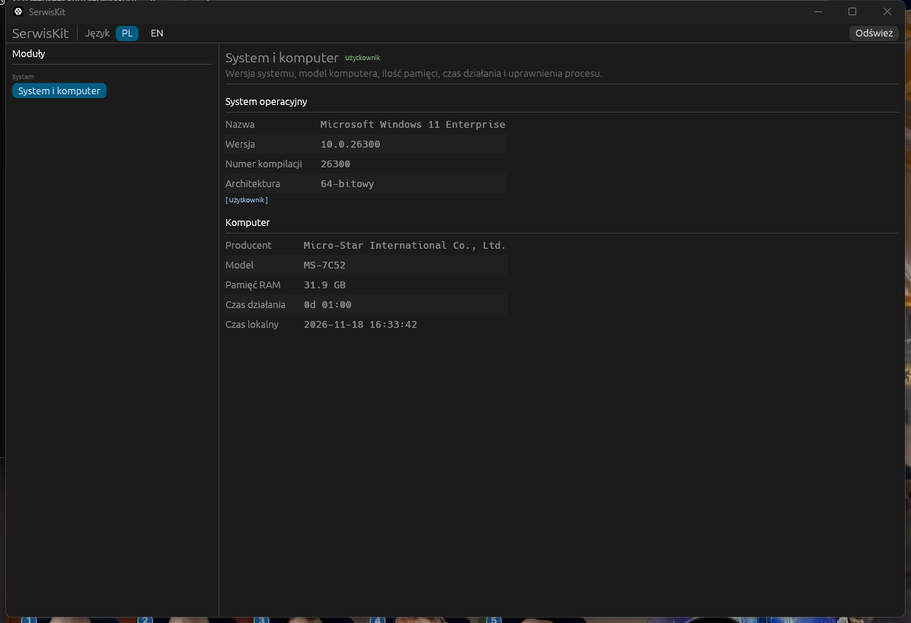

# SerwisKit

Narzędzie serwisowe dla Windows 10/11 x64: diagnostyka sprzętu (jak AIDA64), testy dysków i SMART (jak HD Tune / CrystalDiskInfo) oraz migracja profili przeglądarek między komputerami. Jeden plik `.exe`, praca offline, moduły dokładane przez kontrybutorów.

Projekt open source. Status: **Faza 0 ukończona** — działa szkielet aplikacji (GUI + CLI + rejestr modułów + raport JSON) i pierwszy moduł `system.info`. Kolejne fazy: `docs/PLAN.md` §8.



## Dlaczego

W serwisie komputerowym ta sama czynność wymaga dziś 3–5 programów komercyjnych: AIDA64 do wyceny i raportu, HD Tune do testu dysku, CrystalDiskInfo do SMART, osobne narzędzia do przenoszenia profili i haseł. SerwisKit robi to w jednym oknie, offline, z raportem, który można wydrukować i dołączyć do protokołu.

## Zakres (wersja 1.0)

- **Sprzęt:** CPU, RAM (moduły, sloty), płyta główna, BIOS/UEFI, GPU, monitory (EDID, HDR), bateria (pojemność, zużycie, moc ładowania), dyski, system.
- **Dyski:** SMART NVMe i ATA/SATA, sekwencyjny odczyt całej powierzchni z mapą prędkości, losowy odczyt 4K, czas dostępu, surface test (odczyt), test zapisu tylko za jawnym potwierdzeniem.
- **Migracja:** wykrywanie profili Chrome/Edge/Brave/Firefox, zakładki, historia, ustawienia, hasła w granicach możliwości systemu, zaszyfrowany pakiet `.skpkg`.
- **Raport:** JSON i HTML.

Czego nie ma i dlaczego: temperatury rdzeni CPU, napięcia i obroty wentylatorów wymagają sterownika jądra — świadomie poza wersją 1.0 (`docs/PLAN.md` §2).

## Stos

Rust 1.99 (MSVC) · egui 0.37 / eframe 0.37 (GUI, jeden exe, bez Node i WebView2) · `windows` 0.62 · `wmi` 0.18 · `serde` · `clap` · `chrono` · `include_dir` (wkompilowane tłumaczenia). Kolejne fazy dołożą `egui_plot`, `rusqlite`, `age`.

Struktura: `sk-core` (kontrakt modułów i widoków), `sk-win` (jedyne miejsce z `unsafe`), `sk-modules` (moduły), `sk-app` (binarka `serwiskit`).

Wersja release ma manifest `requireAdministrator` — SMART i testy dysków wymagają administratora. Build deweloperski manifestu nie zawiera, żeby `cargo run` nie wywoływał UAC.

## Budowanie

```powershell
cargo build --release
.\target\release\serwiskit.exe
```

Wymagania: Rust (toolchain MSVC) + Visual Studio Build Tools. Tryb headless:

```powershell
.\target\release\serwiskit.exe report --json raport.json
.\target\release\serwiskit.exe report --json raport.json --module system.info --locale en
```

Bramki jakości (wszystkie muszą być zielone):

```powershell
cargo fmt --all -- --check
cargo clippy --all-targets -- -D warnings
cargo test --all
```

## Dokumentacja

- [`docs/PLAN.md`](docs/PLAN.md) — plan działania, decyzje architektoniczne, zakres, ryzyka, fazy.
- [`docs/MODULE_GUIDE.md`](docs/MODULE_GUIDE.md) — jak dodać nowy moduł (kontrakt, recepta, checklista).
- [`AGENTS.md`](AGENTS.md) — zasady dla kontrybutorów i agentów AI.

## Licencja

GPL-3.0-only (`LICENSE`). Kod pochodny musi pozostać na GPL-3.0. Zależności są GPL-kompatybilne (egui MIT/Apache-2.0, `age` MIT/Apache-2.0, `rusqlite` MIT).

## Bezpieczeństwo i etyka

Narzędzie działa lokalnie i offline, nie wysyła danych użytkownika. Migracja danych wymaga zgody właściciela komputera. Nie implementujemy obejść zabezpieczeń przeglądarek (App‑Bound Encryption) ani blokad plików — to techniki charakterystyczne dla infostealerów.
