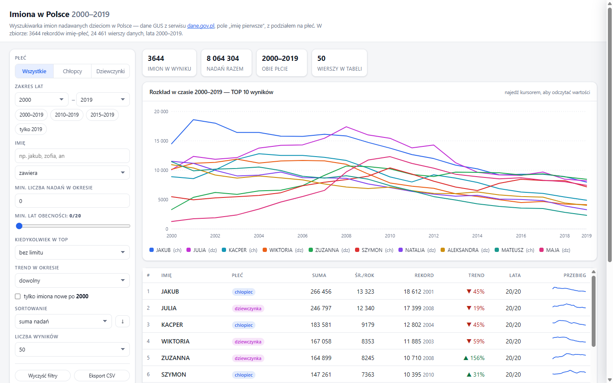

# Wyszukiwarka imion 2000–2019

Samodzielna strona (jeden plik HTML + wygenerowane dane) do przeszukiwania zbioru
GUS „Imiona nadane dzieciom w Polsce w latach 2000–2019 – imię pierwsze”.

Działa offline, bez serwera i bez instalowania czegokolwiek: wystarczy otworzyć
`imiona.html` w przeglądarce (dwuklik).



## Pliki

| Plik | Rola |
|---|---|
| `imiona.html` | cała aplikacja (HTML + CSS + JS, bez zależności) |
| `imiona-data.js` | dane wygenerowane przez `build.ps1` — nie edytuj ręcznie |
| `build.ps1` | CSV → `imiona-data.js` (waliduje każdy wiersz) |
| `data/imiona-2000-2019.csv` | migawka źródła: `Rok,Imię,Liczba,Płeć` |
| `screenshot.png` | podgląd interfejsu |

## Użycie

Dwuklik na `imiona.html`. Jeśli chcesz zachować stan filtrów, możesz go wysłać
linkiem — filtry trafiają do `#hash` adresu i odtwarzają się po wczytaniu.

Skróty: `/` ustawia kursor w polu imienia, `Esc` zamyka panel szczegółów.

## Filtry

| Filtr | Działanie |
|---|---|
| Płeć | wszyscy / chłopcy / dziewczynki |
| Zakres lat | dowolny od–do (2000–2019) + presety: cały okres, dekada, 5 lat, jeden rok |
| Imię | `zawiera` / `zaczyna się od` / `dokładnie`; ignoruje polskie znaki (`lukasz` = `ŁUKASZ`); kilka imion po przecinku = suma wyników |
| Min. liczba nadań | suma w wybranym okresie |
| Min. lat obecności | ile lat z zakresu musi mieć nadania |
| Kiedykolwiek w TOP | imię, które w którymkolwiek roku było w pierwszej N swojego rankingu (ranking liczony osobno dla płci) |
| Trend | rosnący > +20%, stabilny ±20%, malejący < −20% |
| Tylko nowe | imiona, których pierwsze nadanie wypadło po początku zakresu |
| Sortowanie | suma, średnia/rok, rekord, trend, liczba lat, alfabetycznie, pierwsze/ostatnie nadanie (klik w nagłówek też sortuje) |
| Liczba wyników | 25 / 50 / 100 / 200 / wszystkie |

Dodatkowo: wykres TOP 10 (klik w legendę ukrywa serię, kursor pokazuje wartości
roku), przebieg w tabeli, panel szczegółów (rok po roku: liczba, pozycja
w rankingu, udział w płci) oraz eksport przefiltrowanych danych do CSV
(`;`, UTF-8 z BOM — otwiera się poprawnie w polskim Excelu).

## Przebudowa danych

```powershell
# z lokalnej migawki CSV
powershell -ExecutionPolicy Bypass -File tools\imiona\build.ps1

# odświeżenie ze źródła (dane.gov.pl / GUS) + przebudowa
powershell -ExecutionPolicy Bypass -File tools\imiona\build.ps1 -Download
```

Skrypt przerywa pracę z błędem, gdy CSV ma nieoczekiwany nagłówek, złą liczbę
pól, nieliczbowy rok/liczbę, nieznaną płeć albo duplikat `rok+imię+płeć`.

## Dane i ograniczenia

- Źródło: <https://dane.gov.pl/pl/dataset/219/resource/21458> (GUS), plik CSV,
  24 461 wierszy, 3 644 par imię+płeć, 3 602 różne imiona, lata 2000–2019.
- Tylko **imię pierwsze** i tylko zbiorczo dla Polski — brak podziału na
  województwa/gminy i brak imion drugich.
- Najmniejsza liczba nadań w zbiorze to **2** — imion nadanych jednokrotnie
  w danych nie ma, więc suma „wszystkich” imion nie równa się liczbie urodzeń.
- Ranking i udział w płci liczone są w obrębie płci i roku, na tym samym zbiorze.

## Liczby kontrolne (zgodne z danymi źródłowymi)

| Sprawdzenie | Wartość |
|---|---|
| JAKUB, suma 2000–2019 | 266 456 (rekord 18 612 w 2001) |
| JULIA, suma 2000–2019 | 246 797 (rekord 17 399 w 2008) |
| suma całego zbioru | 8 064 304 |
| imion, które były kiedykolwiek w TOP 10 | 42 |
